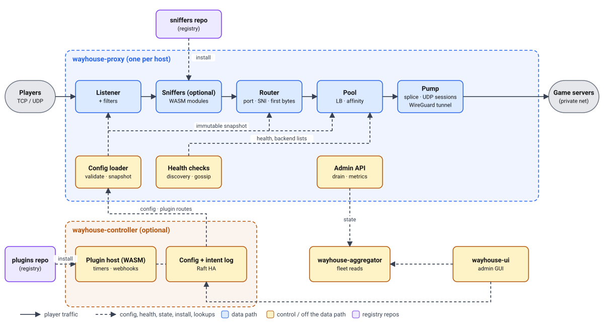

This is the page to read first. It explains the shape of the whole system and the few rules that produced it, and it points to the page that goes deep on each part. The numbered design chapters after it are the long form, and the sections below it are one write-up per mechanism.

## The problem

A game server is a bad thing to put on the internet. Its address is public, so a flood aimed at it takes it down. A fleet of match servers needs a different address or port for each, and something has to send each player to the right one. A deploy disconnects whoever is connected. And every game rebuilds metrics, block lists and logging from scratch.

wayhouse is one reverse proxy that does this for any game. It works on **layer 4**, TCP and UDP, and knows no game. Where a game does give a hint in its first packet, such as a TLS server name or a handshake that names a host, a small sandboxed module reads it, and everything else about the game stays outside the core. Matchmaking, anti-cheat and packet rewriting are non-goals, and so is replacing a scrubbing provider against volumetric floods.

## The rules everything follows

1. **The data path is small, and nothing on it waits.** A connection or datagram costs one lookup in an immutable snapshot and then bytes moving. On Linux a TCP connection moves its bytes with `splice` and never copies them into userspace. Every per-connection step is written down in the [latency ledger](../../latency-ledger.md).
2. **Configuration is a value, not state.** The whole configuration is one immutable **snapshot**. A change builds a new snapshot beside the old one and swaps one pointer. Readers never lock, and a change is all or nothing. See [immutable snapshots and hot reload](../topics/snapshot-and-hot-reload.md).
3. **Everything that can stop is off the data path.** The controller, the aggregator, the console, the registries and the web gateway can all be down while players keep connecting. A proxy runs on its last good snapshot and keeps health state it learned. The one bounded exception is the wait for first bytes when a route needs them.
4. **Learned state survives a change.** A new snapshot inherits each backend's health, its operator state and its live session count by address. A reload never sends players to a server the proxy already knows is down.
5. **Extensions are sandboxed, and the sandbox depends on where they run.** A **sniffer** runs on the data path, sees only the bytes it is handed and has a hard time limit. A **plugin** runs in the controller, off the data path, and can do only what its declaration says and an operator approved. See [sniffers](../topics/sniffers.md) and [plugins](../topics/plugin-host.md).
6. **No shared session state.** Instances are independent on the data path. The control plane shares configuration and health, never sessions, so a client that lands on another instance reconnects. High availability of the proxy tier is a job for anycast or a layer 4 load balancer in front.
7. **Every component gets the weakest credential that works.** A proxy can read its config and fetch its own secrets but cannot write config. The console never holds the admin token. See [enrollment](../topics/enrollment.md) and [secrets](../topics/secrets.md).

## The picture

<picture>
  <source media="(prefers-color-scheme: dark)" srcset="../../img/architecture-overview-dark.svg">
  
</picture>

The blue boxes are the data path and the amber ones are everything beside it. The detailed picture, with every component of one proxy, is in [chapter 02](../../02-architecture.md).

## The life of a connection

Follow one player.

1. **Accept.** The proxy binds one socket per worker with `SO_REUSEPORT` and the kernel spreads connections over them ([listeners](../topics/data-plane-listeners.md)). UDP is a separate loop that reads datagrams in batches ([UDP](../topics/udp-sessions.md)).
2. **Filter.** Allow and deny lists, GeoIP, the rate limit and the per source cap run before anything is allocated for the connection ([filters and limits](../topics/filters-and-limits.md)).
3. **Peek.** If a route needs the first bytes, the proxy peeks at up to 4096 of them without consuming them, for at most 250 ms. A client that says nothing is routed as if it sent nothing, which is how protocols where the server speaks first still work ([routing and matchers](../topics/routing-and-matchers.md)).
4. **Route.** The first matching route wins. Its matcher can be a CIDR, a port, a destination address, a TLS server name, a byte pattern, a sniffer's verdict, a route hint someone pushed, or an answer from your own service ([external resolvers](../topics/external-resolvers.md)).
5. **Choose a backend.** The pool picks a healthy one by its strategy, and a consistent hash pool does it with no table. Backends come from the config, from DNS SRV, Consul or Kubernetes ([pools](../topics/pools-and-load-balancing.md), [discovery](../topics/backend-discovery.md)), and are kept honest by active and passive checks plus regional gossip ([health](../topics/health-checking.md), [gossip](../topics/gossip-health.md)).
6. **Connect and tell the backend who the player is.** A backend with no public address is reached through the WireGuard tunnel ([the tunnel](../topics/tunnel-client.md)). The real client address travels in a PROXY protocol header, or by transparent proxying ([PROXY protocol](../topics/proxy-protocol.md)).
7. **Pump.** Bytes move until either side ends, with half-close and one idle clock for both directions ([the pump](../topics/connection-pump.md)). Shutdown waits for the last connection.

## The life of a config change

Follow one edit.

1. An operator edits the config in the console, over the API or in a file. The console only edits the same file the proxies read.
2. The controller **validates** it before storing it, because a document no proxy can load would be rejected by the whole fleet at once ([the config schema](../topics/config-schema.md)).
3. It is stored as a new **revision** in an append-only log. A rollback is a new revision with old bytes, so nothing downstream needs a special case ([the controller core](../topics/controller-core.md)). With several controllers the log is replicated by Raft ([controller HA](../topics/controller-ha.md)).
4. It can be **staged**: visible first to a canary group, then promoted. A change that could lock the operator out, such as a new admin address or admin token, is applied on trial and reverts itself unless someone confirms it in time ([config rollout](../topics/config-rollout.md)).
5. Each proxy follows the log and runs the new revision through the **same** apply function a file reload uses: secrets, sniffers, validation, then one swap ([hot reload](../topics/snapshot-and-hot-reload.md)). A proxy that refuses a revision keeps serving the old one.
6. Operations that are not structure, such as adding a backend or draining one, travel in a separate intent log and survive restarts ([config rollout](../topics/config-rollout.md)).

## The programs

| Program                                            | Job                                                                                     | Page                                                      |
| -------------------------------------------------- | --------------------------------------------------------------------------------------- | --------------------------------------------------------- |
| `wayhouse`                                         | The proxy. The data plane and its own admin API.                                        | [admin API](../topics/admin-api.md)                       |
| `wayhouse-minimal`                                 | The same proxy built without the optional features.                                     | [deployment artifacts](../topics/deployment-artifacts.md) |
| `wayhouse-controller`                              | Config log, secrets, tunnel registry, certificates, plugins. One node, or a Raft group. | [controller core](../topics/controller-core.md)           |
| `wayhouse-aggregator`                              | Reads every proxy at once: fleet views, history, fan-out.                               | [aggregator](../topics/aggregator.md)                     |
| `wayhouse-ui`                                      | The console and its backend for frontend.                                               | [UI backend](../topics/ui-backend.md)                     |
| `wayhouse-control`                                 | Controller, aggregator and UI as one process, for a single box.                         | [all-in-one](../topics/all-in-one-control.md)             |
| `wayhouse-agent`                                   | The origin side of the tunnel, next to a game server.                                   | [agent](../topics/tunnel-agent.md)                        |
| `wayhouse-web-sync`, `wayhouse-certsync` and Caddy | The optional web gateway and its certificates.                                          | [web gateway](../topics/web-gateway.md)                   |

## When a piece fails

| Down                      | What still works                                                    | What stops                                                   |
| ------------------------- | ------------------------------------------------------------------- | ------------------------------------------------------------ |
| The controller            | Every proxy keeps serving its last snapshot and its learned health. | New revisions, enrolment, certificate renewal, plugin ticks. |
| One controller of a group | The rest elect a leader and carry on.                               | Nothing, while a majority is up.                             |
| The aggregator            | The data path and the controller.                                   | Fleet views and fan-out calls.                               |
| The console               | Everything, through the API.                                        | The browser front end.                                       |
| A registry                | Everything installed.                                               | Browsing and installing from it.                             |
| Gossip                    | Each proxy judges backends by its own checks.                       | The regional second opinion.                                 |
| An origin agent           | Other origins.                                                      | Backends behind that tunnel peer.                            |
| The web gateway           | Every other listener.                                               | Web sites served through Caddy.                              |

The first row is the one the design is built around. If the controller can stop without a player noticing, the rest of the table follows.

## How the Deep dive is arranged

- **Design** is this page and the numbered chapters, which hold the requirements, the routing model, the technology choices and the decisions behind them.
- **The data plane** follows a connection from accept to backend.
- **Configuration and operating a proxy** covers the snapshot, the admin API, flags, metrics and secrets.
- **Extending the proxy** covers sniffers, resolvers, plugins and registries.
- **The control plane** covers the controller, HA, rollout, enrolment and the aggregator.
- **The tunnel** covers WireGuard to origins that have no public address.
- **Web sites and certificates** covers Caddy and ACME.
- **The console** covers the UI and the shared HTTP toolkit.
- **Building and shipping** covers CI, releases, images, tests and this site.

Each page has the same shape: the problem, the design, what was traded away, and where to look in the source.
